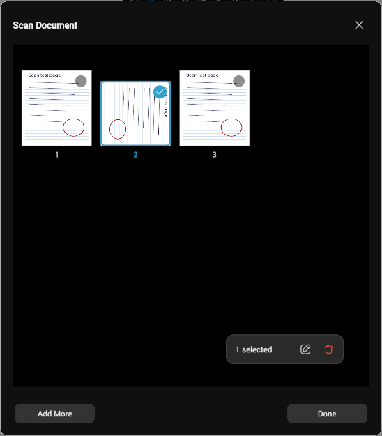

# Document scanning

Photo of a page → adjust four corners → flattened, cleaned-up image, inserted either as an element or
as a new page. Implemented from scratch in C++ rather than via a dependency: ML Kit requires Google
Play Services (ruled out - Write must run on de-Googled devices, and it would be Android-only anyway),
and OpenCV would cost ~1.5-3 MB per ABI plus a CMake build to wire into six toolchains, to use about
five functions. Writing it in `ulib` also means it works identically on Android, iOS, desktop and wasm.

Imaging lives in `ulib` (no dependency on `Painter`/nanovg, so it is unit testable on its own), UI in
`syncscribble/scandialog.cpp`:

- `homography.h`/`.cpp` - `Transform3D`, a 3x3 projective transform. `Transform2D` stays affine (6
  elements) since that is all the renderer needs; perspective correction cannot reuse it. Square-to-quad
  uses Heckbert's closed form, so no general linear solver is needed.
- `imagewarp.h`/`.cpp` - inverse-mapped bilinear warp, rows tiled across `ThreadPool`. **The pool is not
  optional**: 4000x3000 → 2200x1509 is 478 ms single-threaded vs 84 ms threaded. Box-supersamples when
  downscaling (grid from the source/dest area ratio, capped 4x4), or fine text aliases badly. CPU rather
  than GL because nanovg paints are affine, so a GL path would need a custom shader plus FBO readback.
- `imageenhance.h`/`.cpp` - what makes a photo read as a scan is even lighting, not resolution, so the
  core step divides the image by a heavily blurred copy of itself (the blurred copy *is* the
  illumination). A summed-area table makes the blur radius free - 183 px costs the same as 5 px. Then a
  percentile level stretch, and for `SCAN_MONO` a local threshold. 72-119 ms at 2200x1509, unthreaded.
- `quaddetect.h`/`.cpp` - finds the page outline: downscale to ~480 px, Sobel with non-maximum
  suppression, gradient-directed Hough, then **score every left/top/right/bottom combination** of the
  strongest candidate lines and refit the winner. ~35 ms on a 4032x3024 photo. What is load bearing:
  - **No "outermost line" rule.** The first version took the outermost line of each orientation. That is
    right on a flat dark background and wrong on nearly every real photo - a table edge, plank seam,
    laptop, tablecloth or second sheet is always further out than the page - and it is why the user found
    detection "does not work at all" on the iPad. A candidate quad is scored instead by how much of each
    *side* (the segment between its corners, not the infinite line) is a page edge, minus a penalty if the
    edge runs on past the corners: page edges end at the page's corners, clutter lines do not.
  - **Polarity.** The accumulator covers 360 degrees, so a line's normal points to its brighter side, and a
    side only counts where its normal points into the quad. With 180 degrees the page edge and the outer
    edge of its own drop shadow, 2-3 px apart with opposite gradients, merged into one peak that sat on
    the shadow, and the side then found no support.
  - **Two tests per side sample**: an edge pixel within 2 px whose gradient points inward, *and* the pixel
    4 px inside brighter than the one 4 px outside. The second rejects ruled lines, text and pencil marks,
    which have edges of both polarities but the same paper on either side.
  - **Absolute edge threshold with a noise floor** (16, or 1.5x the median gradient), after thinning. The
    old percentile cut ("top 8%, never below 10% of the strongest") was set by handwriting or wood grain,
    and on a white or light desk it dropped the faint page outline entirely - those photos never
    detected at all.
  - The Hough angle alone is not accurate enough: half a degree across a 3500 px edge is ~160 px of
    corner error. Each side is refit by total least squares over the edge pixels **between its corners**
    (so a collinear table edge cannot pull it), **iterated three times** - one pass only sees pixels inside
    its own window and is biased toward the middle of the edge.

  `scribbletest/scantest.cpp` draws realistic photos procedurally (`makeScenePhoto()`: wood with seams,
  gingham, light and white desks, dark fabric; table edge, laptop, pen, second sheet, hand shadow, drop
  shadow, uneven light, noise, JPEG round trip). The old detector failed 5 of those checks. For tuning,
  the standalone build takes `SCANTEST_DUMP=dir` (writes each scene with expected/found corners) and
  `SCANTEST_ONLY=name`. On a randomized sweep of 100 such photos the old detector got 27 right, 35 wrong
  and 38 missed (every light/white desk missed); this one 97 right, 3 wrong (gingham stripes almost
  parallel to a page edge that borders a white square, and a pen touching a corner). Synthetic photos are
  not real ones: if real iPad photos still fail, save one and add it as a fixture.

Corner editing (`ScanCornerWidget`) is **relative, not absolute**: a touch anywhere on the photo grabs
the nearest corner (no hit radius), and the corner then moves `DRAG_RATIO` (0.4) of the finger's travel
from where it went down. The corner never jumps to the finger, so it is never hidden under it and can be
placed more finely than a fingertip can point. Making it follow the finger again undoes both.

Dialog layout: Back (arrow) and Cancel (cross) are in a header around the title, not the bottom row - the
template's `.window-title` node is moved into that row rather than recreated, so it keeps its theme
styling. The bottom row holds only the ways forward: Next on the corner step, **Add More** and Done on the
filter step and the grid. `cancelBtn` is still the dialog's cancel button, so Escape / Android back keep working.

The bottom row's order is fixed on every platform: Add More at the left, Next / Done at the right, each
`BOTTOM_BUTTON_WIDTH` (150) wide with empty space between. The dialog passes `createPopupDialogNode(false)`
on purpose - the default reverses the button row on mobile, which put Done on the *left* on the iPad
(reported as "flipped"), and the full-width halves put the two right next to each other under the thumb.
Width comes from an invisible rect added to each button: the button background is `hfill`, so setting its
own width (`setMinWidth()`) does nothing.

### Add More and the review grid

**Scans stay pending in the dialog until the set is confirmed.** The first version closed the dialog on
Add More, inserted that page, and opened a new dialog for the next photo - so a page could not be taken
back without undo, and every page was its own undo step. Now the dialog stays open for the whole set:

- Steps are `CORNERS` -> `FILTER` -> `GRID`. Add More (filter step or grid) files the page in hand under
  `pending` (`commitCurrent()`: renders the output-size result and a thumbnail), shows the grid, and calls
  `onAddMore`, which is `ScribbleApp::captureScan()`. The photo comes back through `finishScan()`, which
  sees `ScribbleApp::scanDialog` set and calls `ScanDialog::addPhoto()` instead of opening a second dialog.
  On desktop the capture (CameraDialog, file picker) runs nested inside the dialog's click handler; on
  mobile `captureScan()` opens the picker and returns, and the photo arrives later as `INSERT_IMAGE` -
  which still reaches `ScribbleApp`, because SvgGui sends app events to the main window even under a
  modal. A cancelled capture just leaves the grid showing.
- Done on the filter step inserts a lone page at once (the old single-page flow, no grid). Once the set has
  a second page, or the grid has been shown at all (`gridShown`), Done returns to the grid instead, and the
  grid's Done confirms the set. `finishScan()` then inserts everything in order: as pages after the current
  page inside **one** `startAction(where | MULTIPAGE)` / `endAction()` (`insertScanPages()`), as elements
  through `ScribbleArea::insertImages()` - one clipboard, one `doPasteAt()`, stacked top to bottom
  `STACK_GAP` apart. One Ctrl+Z removes the whole set either way (verified for both).
- Cancel (and Escape / Android back) drops every pending page. There is no confirmation.
- Back from the corner step, when there are pending pages, returns to the grid and drops that photo (a
  reopened page keeps what it had).

The grid is the document list's select mode applied to pending pages (ui-floating-bar.md): every cell
shows the empty check badge, a tap toggles the ring and check, and the floating bar (bottom right, 48 / 43,
radius 14, 44x44 buttons) holds a fixed-width count label ("3 pages" / "1 selected"), **Edit Corners**
(enabled with exactly one selected) and **Discard** (destructive, enabled with any). No exit button, since
the grid is a step rather than a mode. The CSS is `ScanDialog::stylesheet`, scoped to `.scan-dialog` and
added by `createStylesheet()` the way `TopBar::stylesheet` is, so no `ugui/theme.cpp` change was needed; it
uses only theme variables (`--doclist-bg`, `--floating-*`, `--badge-*`, `--checked`, `--danger`).
Cells hug the page as the sidebar's page cards do: fixed 132x176 slot, page at its bottom, number under it.
The grid is anchored `top hfill` in its scroller - with only `hfill` a short grid sat about 50 units too
high and clipped the first row.

Edit Corners decodes the stored photo, restores its quad, filter and rotation, and goes to the corner step
with `editIndex` set; committing replaces that page in place, so the warp and enhance are redone from the
original photo, not from the flattened result. Pending photos are kept as JPEG (`photoJpeg`), not raw: a
12 MP photo is ~48 MB decoded, a few MB encoded. A photo decoded from a JPEG file hands back its own bytes
from `encodeJPEG()`, so only camera frames are actually encoded (q92). Results are kept raw at output size
(up to 2200 px, ~13 MB each), which is what the document holds once they are inserted anyway.

To drive this in the agent display, `SUMI_CAMERA=none SUMI_FILE_PICKER=fixed:/path/photo.jpg` makes every
capture, Add More included, return that photo at once.

Where the photo comes from is per platform (`ScribbleApp::scanDocument()`); in every case a
`pendingScan` flag on `ScribbleApp` diverts it into `ScanDialog`:

- **Android** - `insertImage()`'s picker, which is already a chooser merging every
  `MediaStore.ACTION_IMAGE_CAPTURE` activity with the gallery (`MainActivity.getImage()`). The installed
  camera app does the capture, so this needs **no Play Services and no CAMERA permission**.
- **iOS** - `showScanImagePicker()` (`ios/ioshelper.m`): a Take Photo / Photo Library action sheet when
  `UIImagePickerController` reports a camera, the library directly when not (simulator). The camera
  picker cannot reach the library, hence asking first. On iPad the sheet is a popover and must be given
  an anchor, or presenting it throws. Camera photos arrive sideways with an EXIF orientation that
  stb_image ignores, so the picker delegate **redraws any non-`Up` image upright** before encoding - this
  also fixes rotated library photos for plain Insert Image. Needs `NSCameraUsageDescription` in both
  iOS plists, or iOS kills the app when the camera opens.
- **Desktop** - `Camera::list()` (`camera.h`); if it finds anything, `CameraDialog` shows a live preview
  with Capture, a camera combo when there are several, and Choose File... to fall back to the picker.
  No camera means the file picker, exactly as before. `SUMI_CAMERA=none` skips the camera; with
  `SUMI_FILE_PICKER=fixed:/path/photo.jpg` that drives the whole dialog in the agent display without
  opening the host's webcam. Backends, all with the largest frame size the
  camera offers, since a scan wants pixels:
  - Linux `linux/camera_v4l2.cpp` - raw V4L2 mmap streaming, MJPEG preferred over YUYV (bandwidth limited
    to a few fps at full size). Filters on `device_caps`, because a UVC camera exposes a second
    metadata-only `/dev/videoN`. Verified on an eMeet Nova: 1920x1080 MJPEG at ~26 fps, live preview,
    Capture into `ScanDialog`, and the device is closed again on both Capture and Cancel.
  - Windows `windows/camera_mf.cpp` - Media Foundation source reader asked for RGB32 with
    `MF_SOURCE_READER_ENABLE_VIDEO_PROCESSING`, so it inserts the MJPEG/NV12 decoder itself. **Not yet
    compiled or run** - written without a Windows toolchain.
  - macOS `macos/camera_avf.m` (plain C interface, so no Objective-C++ rule) + `macos/camera_mac.cpp`.
    Needs `NSCameraUsageDescription` in `macos/Info.plist`, and the `com.apple.security.device.camera`
    entitlement once the app is signed with a hardened runtime. **Not yet compiled or run.**
  - everything else (wasm) compiles the stub in `camera.cpp`, which lists no cameras.

  **MJPEG trap:** UVC webcams may omit the Huffman tables (DHT) from each frame, and stb_image does not
  fail on that - it decodes noise. `decodeMjpegFrame()` inserts the standard Annex K tables when a frame
  has none (checked: without them stb's output differed from the original by 466832 summed byte values,
  with them by 0).

The `pendingScan` flag must be checked in **two** places: Android and iOS post an `INSERT_IMAGE` event,
but the desktop picker returns a filename and calls `insertImage(filename)` directly, never touching that
event - miss it and desktop silently inserts the raw photo. `insertImage()` clears the flag so a
cancelled picker cannot hijack a later plain image insert.

Output is either an element (`ScribbleArea::insertImage()`, unchanged) or a page background. The page
path follows the same convention as PDF import - image in `ruleNode`, `write-std-ruling` removed,
`write-no-dup` added, `isCustomRuling = true` - but goes through `ScribbleDoc::insertPage()` rather than
writing a file, so it gets undo and sync. Page size comes from the *current page's width* with the
height following the scan's aspect ratio: a scan has no physical scale (`UNITS_PER_POINT` is a PDF
points conversion and is meaningless here), and matching the document keeps scrolling and zoom consistent.

Known gap: a scan of ruled paper leaves `yRuling == 0`, so `Page::yruling(true)` falls back to
`BLANK_Y_RULING` and the ruled tools (insert space ruled, select ruled, ruled eraser) snap to a spacing
unrelated to the lines in the image. The detector's Hough pass already has the data to fix this.
