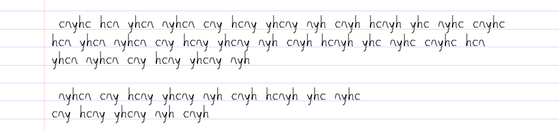
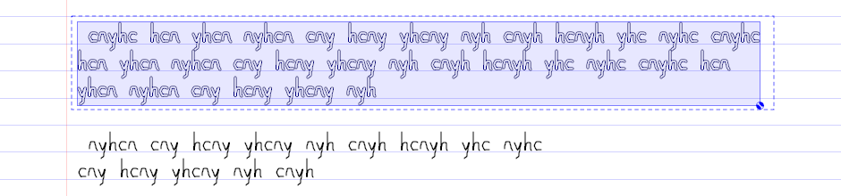
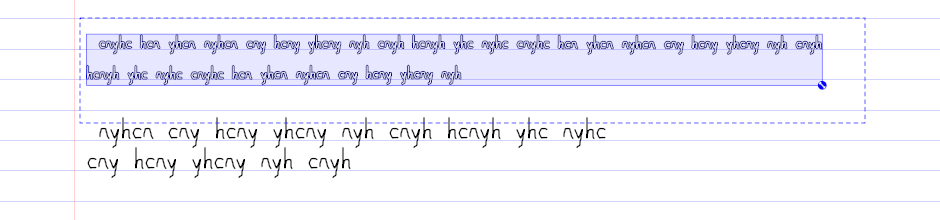

# Smart scale (Resize Handwriting)

A toggle on the selection popup, **Resize Handwriting** (`actionSmart_Scale`, `ID_SMARTSCALE`, icon
`ic_menu_smart_scale.svg` = reicon **`size`**, a large square and a small one). With it on, the selection
loses its square scale handles and rotate handle and gets **one round handle** on its bottom right corner.
Dragging that handle resizes the selected handwriting *on its lines*: every word shrinks (or grows) toward
the rule it sits on, stroke widths scale with it, and the words are laid out again as a paragraph - shrunk
text pulls back onto earlier lines, grown text wraps forward - with whatever follows moving up or down by
the lines freed or taken. It is a button only; the ordinary handles still scale plainly.

| Before | Handle on | After a drag to about 0.6 |
|---|---|---|
|  |  |  |

## Where the code is

- `syncscribble/smartscale.{h,cpp}` - the pure layout, no `Element`/`Page` (tests standalone). Words,
  writer's gap, paragraph layout, unruled baseline estimate.
- `syncscribble/smartscalegesture.cpp` - the `ScribbleArea` side: `canSmartScale()`, `toggleSmartScale()`,
  `smartScaleStart/Move/Finish/Cancel()`. A separate file so `scribblearea.cpp` only gains the switch cases.
- `Selector::smartScale` (the toggle; it lives on the selector, so it ends with the selection) and
  `RectSelector::smartScaleHandleHit()`/`drawBG()`. `offersSmartScale()` stands in for a `dynamic_cast`
  (the build is `-fno-rtti`): only a `RectSelector` has the handle - not a shape's or a region's selector.
- `MODE_SMARTSCALE` (before `MODE_LAST`), `MODEMOD_SMARTSCALE` (0x80), tested first in `selectionHit()`.

## The layout (`smartScaleLayout()`)

Everything is in the ruling frame's local coordinates (`RulingFrame`, so Paper Patches and tilted ones work
like the page). The frame is the one holding most of the strokes' centres - `selectionFrame()`, the vote
`selectionLineHeight()` already used, now shared.

- **Words** are reflow's: strokes on one line (by centre of mass) split where the gap to everything before is
  at least `minWordSep` x pitch (`smartScaleWords()`, same test as `Selection::reflowStrokes()`).
- **Gap** between words is the writer's, as reflow measures it: the median gap, clamped to
  [1.25 x minWordGap, one line] (`writerWordGap()`, now also what `reflowStrokes()` calls), **times the
  scale**, so shrunk text keeps its spacing in proportion.
- **Each word is scaled about the point where its left edge meets its rule** - `(left, (line+1)*pitch)`,
  the bottom of its band, where handwriting sits - and placed at `(x, (newLine+1)*pitch)`. So a word stays on
  a rule whatever the scale; descenders scale below it.
- **Paragraphs** are runs of lines with ink; blank lines between them stay. The first paragraph starts on its
  own first line at its first word's x; continuation lines start at the leftmost start of the paragraph's
  later lines (the first line's own start if it has none), so an indented first line keeps its indent.
- **Lines fill to the selection's own right edge** (the rightmost ink), not the page's: that is the column the
  writer used. A word wider than a line still gets a line of its own.
- **Separators** (`SmartScaleParams::bounds`): beside a vertical or diagonal line the gesture also keeps each
  word's scaled ink between the column's stops at each height (pen-and-tools.md "Separators"); a diagonal "/"
  used to have grown text run across it on the lower lines, since the right edge came from the top line.
  Each word keeps whatever it already crossed, so scale 1 stays identity.
- Greedy fill, `O(words)`: cheap enough to rerun on every move, so **the preview is live** (see below).

## The gesture

- **Drag measure**: the drag projected onto the handle's diagonal from the selection's top left (as a
  region's size grip), clamped to [0.2, 3]. The handle does not stay under the pen: after a reflow the
  selection's corner is wherever the reflowed text ends.
- **Live preview, applied as targets.** Each move recomputes the layout from the press-time boxes and sets
  every stroke's pending transform to its *target* (`target * pending^-1` applied), never stepping from the
  previous move, so nothing accumulates and dragging back to 1 restores exactly. `internalScale` is 1, so the
  scale goes into the node transform and **stroke widths scale with the ink** (the pen-button variant of the
  plain scale handle does the same). Strokes are not rewritten until release.
- **Later content** (everything editable on the same ruling below the selection's last line, in the text's
  column, down to a horizontal separator - a `RuledSelector`, so column stops and `findSectionEnd()` apply;
  not a region) is held in `tempSelection` and translated by whole lines: down by the lines grown text took, up by the lines
  shrunk text freed. **Other ink on the selection's own lines blocks the pull-up**: it is never pulled past the
  lowest such line (`blockedLine`), so text below cannot land on it. Ink in the page margin does not block
  (bookmarks), and a region's frame has no margin.
- **Release** (`smartScaleFinish()`): one undo step. The release's `startAction()`/`endAction()` wrap one
  `StrokeTransformItem` per resized stroke (its pending transform) and one `StrokeTranslateItem` per moved
  later element; both are existing items, so **sync** sends them as it sends any scale or move. The toggle stays
  on, so the size can be adjusted again.
- **Cancel** resets every pending transform. **A peer edit** (`invalidateStroke()`) of a stroke the gesture is
  holding, or of its page (`invalidatePage()`), cancels the drag and keeps the selection - the gesture holds
  `Element*`s.
- **Layers**: the selection already holds only editable ink (`doSelect()`), and later content is filtered by
  `Page::isEditable()`. Locked ink below therefore stays where it is while editable ink moves past it - the
  same as Insert Lines.
- **Unruled paper** (and music staves, whose band is not a line handwriting sits on): no reflow. Plain uniform
  scale, widths included, about `(selection left, baseline estimate)`, where the estimate is the median of the
  strokes' bottoms (`smartScaleBaseline()` - most letters end on the baseline, only descenders below it).
  Nothing else moves.

## Skip Lines

While Resize Handwriting is on, the selection popup also shows **Skip Lines**, the same toggle (and the same
flag, `ScribbleMode::insSpaceSkipLines`) the Insert Space tool offers, kept in step with it. It is read at
the press (`smartScaleStart()`): with it on, the gesture frame is `skippedLineFrame(frame, firstLine)` (first
line = the selection's topmost), so a "line" is a text line plus the blank one below. Nothing else in the
layout changes - reflow wraps to the next text line, later content moves by two-line steps (`dLines` x the
doubled pitch), `blockedLine` is per text line. The one new thing is `SmartScaleParams::baseline`: where the
rule sits in a band, 1 normally (band bottom), **0.5** with Skip Lines, because the doubled band's bottom is
the blank line. Words scale about and are placed on `(line + baseline) * pitch`. Same release, same one undo
step. Not for unruled/staff paper (nothing to skip). Toggling does not re-layout; it applies to the next drag.

## Known gaps

- Grown text pushed past a horizontal separator overlaps it (the separator ends the later content, it does
  not move).
- Ink right of the selection on its last line is not part of the paragraph and stays where it was.
- A word that the reflow word break joins (strokes closer than `minWordSep`) is scaled as one; a word broken
  by a wide letter gap is two.
- Page growth happens on release only (grown text past the page bottom is not shown growing live).
- The popup button is set checked when the popup opens (`refreshSelPopup()`); that look was not checked in a
  screenshot - the round handle is the visible state.
- The new strings are untranslated.

## Tests

- `scribbletest/smartscaletest.cpp` (`runSmartScaleTests()`, standalone: command in its header) - word
  break, writer's gap clamp, scale 1 is identity, shrunk ink on the rules and scaled, half size pulls the
  next line's word back at the scaled gap, line counts, a paragraph break kept, growing wraps to the indent,
  unruled baseline, Skip Lines (rule mid-band; ignoring `baseline` fails 2). Mutation-checked: scaling about the band top (4 checks fail), keeping line breaks / no
  pull-back (5), ignoring paragraph breaks (3), an unscaled gap (2).
- `ScribbleTest::smartScaleTest()` - three full lines on lined paper and a paragraph after a blank line; the
  toggle, the square handles gone, a drag of the round handle to half: two lines, letters on their rules at
  half size (widths too), the paragraph below up one line, still on, one undo step, and one undo restores
  every stroke. Mutation-checked: no later-content move (1 check fails), the commit split into two actions
  (2 fail).
- Verified in agent-display (Debug): the images above.
